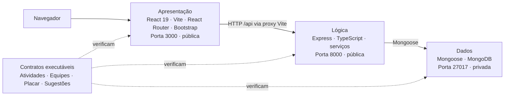

# Arquitetura do OctoFit Tracker

O OctoFit Tracker é uma aplicação de três camadas para um programa de atividades físicas escolar. O código inicial inclui contratos de API e pontos de implementação intencionalmente incompletos para que você use o modo agent do GitHub Copilot em um ciclo guiado por testes.

## Limites entre as camadas

- **Camada de apresentação**: React 19, Vite, React Router, Bootstrap e um cliente compartilhado da API em `octofit-tracker/frontend/src`.
- **Camada de lógica**: rotas e serviços Express com TypeScript em `octofit-tracker/backend/src` expõem o comportamento `/api/*` na porta `8000`.
- **Camada de dados**: modelos Mongoose e dados de demonstração em `octofit-tracker/backend/src/models` e `src/scripts/seed.ts` são persistidos no MongoDB na porta `27017`.

## Portas e regras de ambiente

- MongoDB: `27017` (privada)
- API Express: `8000` (pública)
- Interface Vite: `3000` (pública)
- O navegador acessa caminhos relativos `/api`. O Vite os encaminha para `http://localhost:8000`; `VITE_API_BASE_URL` pode substituir a URL-base.
- Não encaminhe nem torne públicas outras portas.

## Contrato da API

| Capacidade | Método e caminho | Comportamento esperado |
| --- | --- | --- |
| Registro de atividades | `GET /api/activities`, `POST /api/activities` | Lista e cria atividades válidas. POST recebe `userId`, `teamId`, `type` e `minutes`; `userId` e `teamId` devem ser IDs bem-formados de uma pessoa e uma equipe existentes, caso contrário a API retorna um 4xx intencional (nunca um 500 causado por erro de conversão). Uma atividade criada armazena `user`, `team`, `type` e `minutes` enviados, além de `points` e `occurredAt` calculados. |
| Equipes | `GET /api/teams`, `POST /api/teams` | Lista e cria equipes com integrantes. As equipes criadas e listadas mantêm os valores enviados em `name` e `mascot`. Rejeita uma equipe sem nome com `400`. |
| Placar | `GET /api/leaderboard` | Retorna as equipes ordenadas pela soma dos pontos de suas atividades, da maior para a menor. Cada item contém `teamName`, `totalPoints` e uma `rank` iniciada em 1. |
| Sugestões de treino | `GET /api/workouts/suggestions/:userEmail` | Recomenda treinos com base nos padrões de atividade recentes da pessoa correspondente ao e-mail seed. O foco da primeira sugestão (`focus`) corresponde à meta ou à atividade recente dessa pessoa, e o campo `reason` explica o motivo. Um e-mail sem pessoa correspondente retorna um 4xx intencional (por exemplo, `404`). |

## Decisões de implementação

- **Decisão da camada de apresentação:** conectar os componentes ao cliente HTTP compartilhado, com estados acessíveis de carregamento, vazio e erro. Manter o texto visível em português do Brasil.
- **Decisão da camada de lógica:** manter as rotas responsáveis pelo HTTP e implementar validação e regras de negócio nos serviços, retornando erros 4xx intencionais para entradas inválidas.
- **Decisão da camada de dados:** definir nos modelos Mongoose os campos obrigatórios e seus relacionamentos; preservar o seed idempotente e os dados não relacionados.
- **Abordagem para registro de atividades:** validar os campos e a existência de pessoa e equipe, calcular pontos e data, persistir a atividade e disponibilizá-la na listagem.
- **Abordagem para gerenciamento de equipes:** validar nome e mascote, criar equipes com seus integrantes e manter esses dados na listagem.
- **Abordagem para o placar:** somar os pontos das atividades por equipe, ordenar por pontuação decrescente e atribuir posições a partir de 1.
- **Abordagem para sugestões de treino:** localizar a pessoa pelo e-mail, considerar sua meta e atividades recentes e retornar sugestões compatíveis com uma justificativa; retornar 4xx quando ela não existir.

Implementar primeiro os modelos e verificar o seed; depois, os serviços e contratos da API; por fim, as telas e seus estados. Não introduzir autenticação.

## Plano de testes

Executar os comandos a partir da raiz do repositório, após cada etapa correspondente:

1. Testes da camada de dados: `npm run test:data --prefix octofit-tracker/backend`: verificar os modelos e o seed idempotente, incluindo a preservação de dados existentes.
2. Testes da API: `npm run test:api --prefix octofit-tracker/backend`: verificar atividades, equipes, placar, sugestões e respostas para entradas inválidas.
3. Testes do frontend: `npm test --prefix octofit-tracker/frontend`: verificar os dados apresentados e os estados acessíveis das quatro telas.
4. Compilação do backend: `npm run build --prefix octofit-tracker/backend`: verificar a compilação do backend.
5. Compilação do frontend: `npm run build --prefix octofit-tracker/frontend`: verificar a compilação do frontend.

### Falhas relatadas inicialmente

- **Dados:** quatro testes de validação falham porque os modelos ainda não exigem os campos previstos; o teste de seed não foi listado entre as falhas.
- **API:** os quatro testes falham: criação de atividades e equipes, ordenação do placar e sugestões personalizadas. Os serviços correspondentes estão incompletos.
- **Frontend:** os 15 testes relatados falham porque as telas ainda exibem conteúdo provisório, sem consultar a API nem apresentar os estados esperados.
